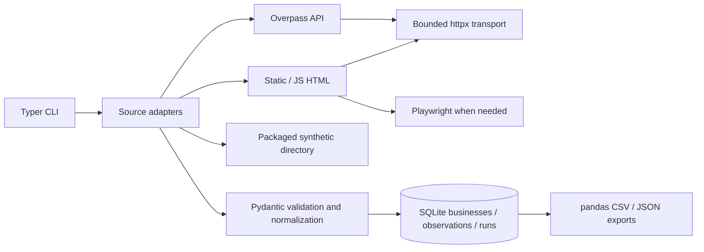

# LeadRadar

**A Python CLI that turns public business listings into clean, attributed B2B lead lists.**

LeadRadar addresses a common sourcing problem: manual copy/paste produces inconsistent records,
repeated entries, and lists with no evidence of where the data came from. Stage 1 collects public
business data, validates and normalizes it, stores it in SQLite, and exports spreadsheet-safe CSV
and JSON. It does not invent missing details or claim that a listing is a verified sales prospect.

## Features

- Live OpenStreetMap Overpass integration with a small geographic scope and business category.
- Real multi-page BeautifulSoup scraping against a packaged, explicitly synthetic directory.
- Configurable static and JavaScript directory adapters for sources whose terms permit collection.
- HTTP timeouts, bounded exponential retries, Retry-After, request/response budgets, and rate limiting.
- Robots checks for HTML, same-origin pagination, and clear refusal of denied access or redirects.
- Pydantic validation, Unicode/text cleaning, URL normalization, and conservative deduplication.
- Atomic SQLite upserts, numbered migrations, source observations, and collection-run reports.
- UTF-8 CSV/JSON exports, provenance, attribution, category/region filters, and formula protection.
- JSON event logs to stderr and interruption recovery that keeps already committed records.

## Architecture



Python **3.12+**, Playwright, BeautifulSoup, httpx, pandas, Pydantic, Typer, SQLite, pytest,
Ruff, and GitHub Actions. No paid accounts, API keys, Docker, or cloud infrastructure are needed.

## Install on Windows 10/11 (PowerShell)

Install Python 3.12+ and Git, then:

```powershell
git clone https://github.com/NotThatBoii/LeadRadar.git
Set-Location LeadRadar
git switch feat/stage-1-b2b-list-builder
py -3.12 -m venv .venv
.\.venv\Scripts\python.exe -m pip install -e '.[dev]'
.\.venv\Scripts\leadradar.exe --help
```

Activation is optional: these commands use explicit executables and work without changing your
PowerShell execution policy. Only the JS adapter/browser test needs a browser download:

```powershell
.\.venv\Scripts\python.exe -m playwright install --no-shell chromium
```

## CLI usage

The global `--db` option goes **before** the command. Default: `data/leadradar.db`.
`LEADRADAR_DB` can also set the path. Runtime databases, exports, logs, and environments are ignored
by Git. No secret configuration is necessary.

```powershell
.\.venv\Scripts\leadradar.exe sources
.\.venv\Scripts\leadradar.exe --db data/fixture.db collect --source fixture --limit 100
.\.venv\Scripts\leadradar.exe --db data/fixture.db collect --source fixture --limit 100
.\.venv\Scripts\leadradar.exe --db data/fixture.db list --kind fixture
.\.venv\Scripts\leadradar.exe --db data/fixture.db stats
.\.venv\Scripts\leadradar.exe --db data/fixture.db export --kind fixture --format csv --output exports/fixture.csv
.\.venv\Scripts\leadradar.exe --db data/fixture.db export --kind fixture --format json --output exports/fixture.json
```

This fixture has **five appearances and four unique synthetic businesses across two pages**.
The first run inserts four; repeating it inserts zero and counts five duplicate appearances.
It intentionally includes missing data and an invalid website. `.example`/`.invalid` names are
test data. `list` and `export` default to **live** records, so fixtures require `--kind fixture`.

Live example: restaurants in a bounded area around Makati, Philippines. The geographic query
does **not** populate missing city, region, or country fields; only source tags do that.

```powershell
.\.venv\Scripts\leadradar.exe --db data/live.db collect --source overpass --bbox '14.54,121.00,14.59,121.05' --tag amenity=restaurant --limit 150
.\.venv\Scripts\leadradar.exe --db data/live.db stats
.\.venv\Scripts\leadradar.exe --db data/live.db list --limit 5
.\.venv\Scripts\leadradar.exe --db data/live.db export --format csv --output exports/makati-restaurants.csv
.\.venv\Scripts\leadradar.exe --db data/live.db export --format json --output exports/makati-restaurants.json
```

`collect` supports `--limit 1..500`, `--max-requests 1..100`, `--interval 1..60` seconds, and
`--timeout 1..120` seconds. Overpass enforces an interval of at least five seconds. All retries,
robots requests, and browser resource requests count toward the request budget. Up to three
attempts use exponential backoff; long server cooldowns stop the run with a diagnostic.
Avoid repetitive live reruns; use the offline repeatability demonstration/tests instead.

`list` supports `--kind live|fixture`, `--limit 1..1000`, `--region`, and `--category`.
`export` supports `--format csv|json`, `--output`, `--kind`, `--region`, and `--category`.
Filters are exact and case-insensitive; absent region tags cannot match a region filter.
Existing export files are protected: choose a fresh output path for another export.
`stats` shows separate live/fixture counts and the ten most recent run reports.
Use `COMMAND --help` for every option. Exit codes: 0 success, 1 partial/failed run or operational
error, 2 invalid CLI arguments, 130 interrupted collection.

## Supported sources

| Adapter | Input | Permissions and behavior |
| --- | --- | --- |
| `overpass` | Bounding box and OSM tag | One bounded POST to the public Overpass API; OSM attribution/ODbL |
| `fixture` | Bundled directory pages | Offline, synthetic, clearly labelled; demonstrates actual pagination |
| `directory` | Reviewed JSON config | Static public HTML, robots checks, stable card identifiers |
| `directory-js` | Reviewed JSON config | Same requirements; Playwright Chromium renders JS |

Only Overpass is a pre-reviewed live integration. A configurable adapter does not imply that any
particular third-party directory permits scraping. See [source policies and configuration](docs/sources.md).

## Storage, cleaning, and provenance

`businesses` stores a unique conservative identity, normalized JSON payload, indexed domain/category/
region, fixture/live type, and first-collected, last-updated, and last-seen UTC timestamps.
`observations` has a unique `(source, source_record_id)` key, a foreign key to the business, and the
original and normalized values for every contributing source. `collection_runs` stores start/end,
status, processed/new/updated/duplicate/failed counts, requests, errors, and warnings. Reports count
input appearances, so a repeated card on another page counts again as a duplicate.

Schema versions use transactional migrations and SQLite `PRAGMA user_version`; newer incompatible
databases are rejected. Every record upsert is an immediate transaction with foreign keys enabled,
WAL journaling, parameterized values, and unique constraints. See [architecture](docs/architecture.md).

Text uses NFKC Unicode and whitespace normalization. Website normalization accepts HTTP(S), adds
HTTPS to scheme-less domains, converts IDNs, removes tracking parameters/fragments, and derives a
domain without a leading `www.`. It preserves subdomains and business URL paths; it does not guess
registrable domains. Invalid websites become null with a warning and retain their original value.
Blank required business names fail validation. Missing optional fields stay null.

Existing source IDs always update the same business. Cross-record matches require **canonical
domain + normalized exact name + precise location** (coordinates, or street/city/country).
A shared domain or similar name alone never merges records. Without a precise location, the
source ID is the fallback. This favors avoiding false merges; some real duplicates remain.
The first matching signature is retained when a known listing changes. The first source remains
authoritative in the business view; conflicting later observations remain available in exports.
No fuzzy matching or hidden enrichment is performed.

`original_values` and `field_provenance` distinguish source facts from normalized/derived values.
"valid" means structural validation only, not that a business is current, reachable, or consenting
to outreach. `last_updated_at` changes on content/provenance changes; unchanged repeats update
`last_seen_at` only. A forced termination may leave a run marked `running`; committed records survive.

## Export format

CSV has stable snake_case headers, a UTF-8 BOM for Excel, blank cells for missing values, and
JSON-encoded provenance columns. JSON is an array with null missing values and structured
observations. Both include source identifiers/URLs, timestamps, validation, attribution, and license.
Values beginning with formula triggers receive a leading apostrophe, including phone numbers
starting with `+`. This also applies recursively to JSON for spreadsheet import; original values
are preserved unescaped in SQLite. Consumers that need untouched source strings should use SQLite.

Example **synthetic** excerpt (not a live lead):

```json
{
  "business_name": "Sample Copper Café",
  "website": "https://www.copper.example/",
  "domain": "copper.example",
  "category": "cafe",
  "source": "fixture",
  "source_record_id": "fixture-001",
  "source_kind": "fixture"
}
```

## Tests and demonstration

```powershell
.\.venv\Scripts\python.exe -m pytest -m 'not browser' --cov=leadradar --cov-report=term-missing
.\.venv\Scripts\python.exe -m pytest -m browser
.\.venv\Scripts\python.exe -m ruff check .
.\.venv\Scripts\python.exe -m ruff format --check .
.\.venv\Scripts\python.exe examples/demo.py
```

Normal tests use deterministic fixtures and `httpx.MockTransport`; external HTTP is blocked.
The browser test runs actual Chromium with all page requests fulfilled from mocked fixture
responses through the application's guarded HTTP transport. CI runs unit tests on Windows/Linux
with Python 3.12/3.13 and runs the browser check separately. No live OSM requests occur in CI.

The demo performs two fixture collections, verifies SQLite counts, exports both formats, and
shows recovery from a simulated HTTP 503. Runtime outputs go to a fresh ignored artifacts directory.
Verified locally on 2026-10-18: **97 tests passed, 0 failed**, **91% statement coverage**, Ruff lint
and formatting passed, and a real Overpass collection stored **150 unique restaurant listings**.
Repeating that live query added zero records and counted 150 duplicates. Only 9 of the 150 source
listings supplied websites; absent contact data remains absent.
[Verification results and real-world demonstration](docs/verification.md) report actual outcomes,
including the live record count and limitations. They are evidence for the recorded run, not a
guarantee of future source availability. No performance claims or fabricated screenshots are included.

## Responsible use and limitations

Overpass usage guidance was reviewed on **2026-10-18**. Small, occasional queries fit this demo;
public instances must not serve as the sustained backend for a general commercial application.
Use a permitted hosted/private instance or licensed bulk data for production. Do not tile regions
to harvest global data, parallelize requests, or change endpoints to evade limits.
[Overpass guidance](https://dev.overpass-api.de/overpass-doc/en/preface/commons.html).

OSM-derived data requires **© OpenStreetMap contributors**, attribution, and identification of the
ODbL license. Publicly distributing an adapted database can carry share-alike and database-access
obligations. The MIT license covers this software, not OSM records.
[OSM copyright](https://www.openstreetmap.org/copyright) and
[ODbL legal text](https://opendatacommons.org/licenses/odbl/1-0/).
Keep attribution/license columns when sharing exports and assess obligations for your distribution.

Collect only public business details allowed by source terms. No private profiles, authenticated
pages, CAPTCHA solving, proxy rotation, stealth, contact discovery, or unsolicited messaging are
implemented. Business phone tags are unverified public source listings; they may still identify a
sole trader. Review/redact exports as appropriate before use or publication. API coverage can be
sparse/outdated; a local-area query can return fewer records than requested. Generic directories
need stable `data-id`/`id` cards and CSS selectors. Redirects and cross-origin JS dependencies are
refused, so some otherwise permitted sites need a source-specific adapter. There is no automatic
terms interpretation, domain ownership verification, address geocoding, or legal permission inference.

## Roadmap

Stage 1 focuses on functional data sourcing. Future work can add more individually reviewed source
adapters and better explicit entity reconciliation. Stage 2 may add company enrichment. Stage 3 may
add Apify/n8n deployment, schedules, webhooks, Sheets integration, and scoring. None of those systems
or paid services is implemented here.

## License

Software: [MIT](LICENSE), retaining the repository's original license. OSM data: ODbL as above.
